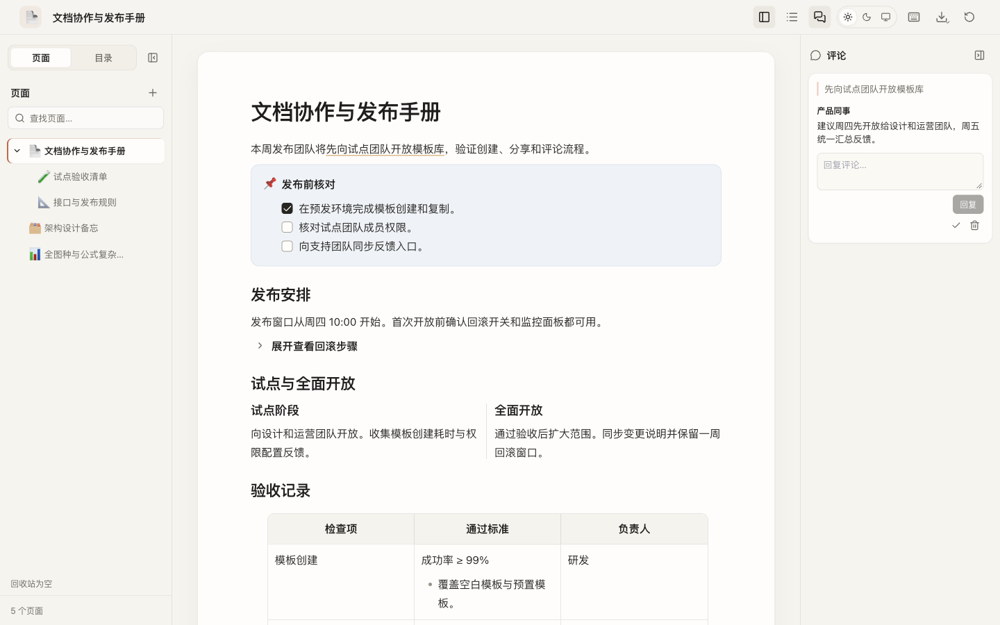

# AIBlock Editor

用块组织长文档的本地编辑器，支持浏览器、macOS 桌面端和面向 AI 工具的 CLI。

[](https://exposir.github.io/aiblock-editor/)
[](https://github.com/exposir/aiblock-editor/actions/workflows/deploy-docs.yml)
[](LICENSE)
[](https://nodejs.org/)

<picture>
  <source media="(prefers-color-scheme: dark)" srcset="docs/public/images/editor-dark.png">
  <source media="(prefers-color-scheme: light)" srcset="docs/public/images/editor-light.png">
  
</picture>

## 能做什么

- **用块排版。** 拖动单块或多块来重排，用提示块、折叠块和分栏组织内容。输入 `/` 或 `、`，用中文、拼音或英文找块。
- **管理多页笔记。** 用页面树归类，用大纲跳到段落，用划词评论记录上下文。支持浅色、深色与跟随系统。
- **用 Markdown 交换内容。** 读取、导出或复制整页 Markdown，也能直接把符合 Markdown 结构的纯文本粘贴成块。
- **在文档里画图和写公式。** 预览 Mermaid 图表和 KaTeX 公式，切换源码和预览视图，也可把图表导出为 SVG。
- **批量贴图。** 一次最多插入 200 张 PNG、JPEG、GIF 或 WebP，整批可以一步撤销。
- **从终端编辑桌面文档。** 用 `aiblock-doc` 搜索页面、阅读大纲和局部小节、精准替换块、回复划词评论，并通过回收站安全删除或恢复。也支持创建与整页替换、图片导入和资产回收。打开的桌面端能感知变更，并会提示写入冲突。

## 快速开始

需要 Node.js `^22.12.0 || ^24.0.0 || >=26.0.0` 和 pnpm 12。

敲下以下命令后，打开 Vite 输出的本地地址。页面树里有示例可直接打开。

```sh
git clone https://github.com/exposir/aiblock-editor.git && cd aiblock-editor
pnpm install
pnpm dev
```

开发桌面端时，从同一仓库运行以下命令，脚本会为 Electron 启动独立的 Vite 服务。

```sh
pnpm electron:dev
```

用 `pnpm electron:pack` 生成可在本机运行的 macOS 应用包。Apple Silicon 的默认产物位于 `release/mac-arm64/AIBlock Editor.app`。有关数据目录和签名说明，见[快速开始](https://exposir.github.io/aiblock-editor/guide/getting-started)。

## CLI 与 Agent Skill

CLI 与桌面端共用工作区。macOS 的默认工作区是 `~/Library/Application Support/aiblock-editor/workspace`，也可用 `--workspace` 或 `AIBLOCK_WORKSPACE` 指定其他目录。浏览器工作区独立保存。

```sh
pnpm cli:build
pnpm cli -- list
pnpm cli -- search '会议记录'
pnpm cli -- outline @active --blocks
pnpm cli -- get @active --section "$heading_block_id" --with-block-ids
pnpm cli -- patch @active --if-match "$etag" --replace-section "$heading_block_id" --markdown notes.md
pnpm cli -- comments @active --unresolved
pnpm cli -- create --title '会议记录' --markdown notes.md
pnpm cli -- delete @active --if-match "$index_etag"
pnpm cli -- add-image screenshot.png
pnpm cli -- gc --dry-run
```

页面参数可写 `@active`，也可用 `list` 或 `search` 取得 UUID。`etag` 来自 `get`，`index_etag` 来自 `list` 或 `comments`。创建页面的示例从当前目录读取 `notes.md`。

[Agent Skill](skills/aiblock-doc/SKILL.md) 说明如何让 AI 工具定位工作区、读写页面和处理版本冲突。[CLI 在线使用指南](https://exposir.github.io/aiblock-editor/guide/cli-and-skill)

## 文档导航

| 页面 | 内容 |
| --- | --- |
| [快速开始](https://exposir.github.io/aiblock-editor/guide/getting-started) | 选择 Web、桌面或 CLI，安装并运行 |
| [块编辑与 Markdown](https://exposir.github.io/aiblock-editor/guide/blocks-and-markdown) | 排版、快捷键、导入导出、图表和公式 |
| [CLI 与 Agent Skill](https://exposir.github.io/aiblock-editor/guide/cli-and-skill) | 安装、调用及桌面工作区同步 |
| [架构与实测](https://exposir.github.io/aiblock-editor/guide/architecture) | 存储、编辑器浮层和 Chromium 测量 |
| [开发与排查](https://exposir.github.io/aiblock-editor/guide/development) | 目录结构、类型检查、测试与压测 |
| [CLI 参考](https://exposir.github.io/aiblock-editor/reference/cli-api) | 命令参数、JSON 输出和退出码 |

## 本地验证

```sh
pnpm tsc --noEmit
pnpm test
pnpm docs:build
```

文档构建输出在 `docs/.vitepress/dist/`。运行 `pnpm docs:dev` 编辑和预览文档，运行 `pnpm docs:preview` 查看构建产物。完整验证步骤见[仓内开发指南](docs/guide/development.md)。

## 反馈与贡献

提交问题时，附上 Web 或桌面端、系统和版本、复现步骤及预期结果。编辑问题可以附一小段可公开的 Markdown 示例。[GitHub Issues](https://github.com/exposir/aiblock-editor/issues)

修改文档时，可从站点页面底部的「在 GitHub 上编辑此页」进入源文件。CLI 契约的修改集中在[参考原文](skills/aiblock-doc/references/cli-reference.md)。

## 许可

项目源码采用 [MIT 许可证](LICENSE)。分发应用包时应保留运行时和第三方依赖各自要求的许可声明。
